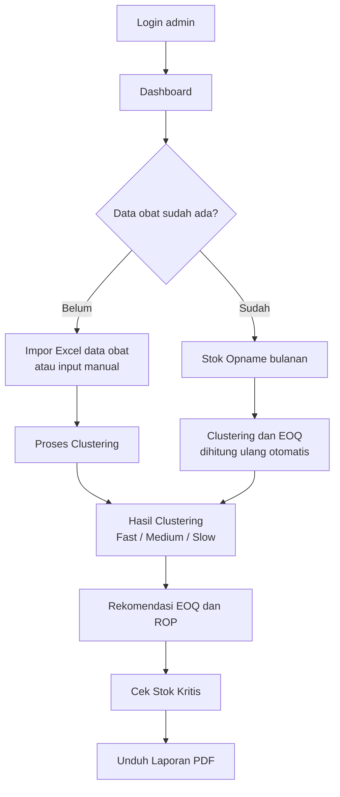
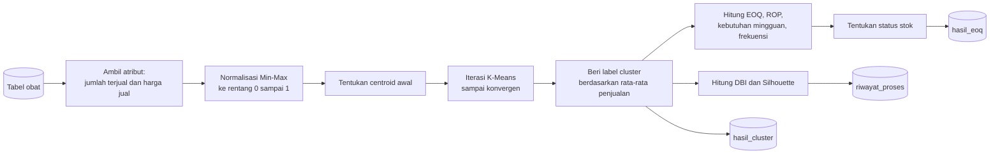
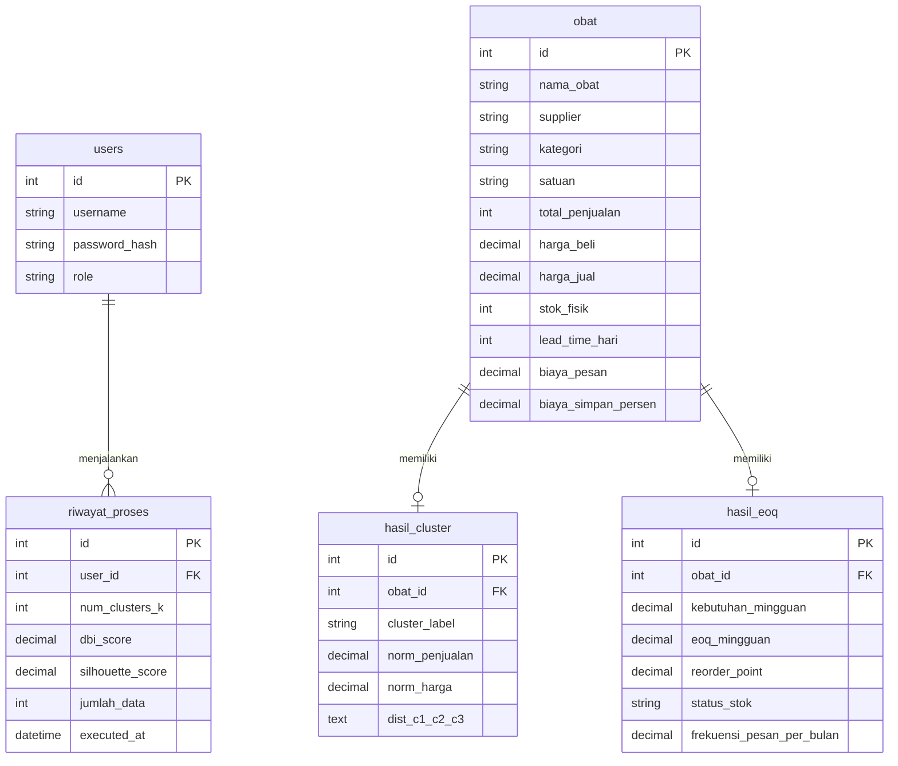

# Apotek Signa Medika: Klasifikasi Obat dan Rekomendasi Pengadaan

Aplikasi web untuk membantu Apotek Signa Medika (Kec. Legonkulon, Kab. Subang) memutuskan obat mana yang perlu dipesan, berapa banyak, dan kapan. Sistem mengelompokkan obat menjadi **Fast Moving**, **Medium Moving**, dan **Slow Moving** dengan algoritma K-Means, lalu menghitung jumlah pesanan ekonomis (EOQ) dan titik pemesanan ulang (ROP) untuk setiap obat.

Proyek ini dibuat sebagai Tugas Akhir.

## Daftar Isi

- [Fitur](#fitur)
- [Teknologi](#teknologi)
- [Alur Kerja Sistem](#alur-kerja-sistem)
- [Metode Perhitungan](#metode-perhitungan)
- [Instalasi](#instalasi)
- [Format File Excel](#format-file-excel)
- [Struktur Folder](#struktur-folder)
- [Skema Database](#skema-database)
- [Pengujian](#pengujian)

## Fitur

| Menu | Fungsi |
|---|---|
| Dashboard | Total obat, jumlah per cluster, jumlah obat berstok kritis, grafik distribusi cluster, dan 10 obat terlaris |
| Data Obat | Tambah, ubah, hapus data obat, serta impor massal dari Excel/CSV (obat yang namanya sudah ada akan diperbarui) |
| Stok Opname | Unduh template berisi seluruh nama obat, isi stok dan penjualan bulan ini, lalu unggah. Clustering dan EOQ dihitung ulang otomatis |
| Proses Clustering | Grafik Elbow untuk membantu memilih K, lalu menjalankan K-Means dan EOQ |
| Hasil Clustering | Tabel hasil per obat, scatter plot, nilai DBI dan Silhouette, serta rincian perhitungan langkah demi langkah |
| Rekomendasi EOQ | Jumlah pesanan optimal, ROP, kebutuhan mingguan, dan frekuensi pesan per bulan |
| Stok Kritis | Daftar obat dengan stok di bawah atau sama dengan ROP. Notifikasi lonceng di header mengambil data dari sini |
| Laporan | Pratinjau laporan dan unduh dalam format PDF |

## Teknologi

- Python 3.11, Flask 3.0 (pola MVC dengan Blueprint)
- Flask-SQLAlchemy, Flask-Migrate, Flask-Login
- MySQL / MariaDB melalui PyMySQL
- pandas, NumPy, scikit-learn (MinMaxScaler, KMeans, davies_bouldin_score)
- openpyxl untuk baca/tulis Excel, xhtml2pdf untuk ekspor PDF
- Bootstrap 5, Bootstrap Icons, Chart.js di sisi tampilan
- pytest untuk pengujian

## Alur Kerja Sistem

### Alur pengguna



### Alur pemrosesan data



Setiap kali proses dijalankan, isi tabel `hasil_cluster` dan `hasil_eoq` dihapus lalu diisi ulang, sementara `riwayat_proses` menyimpan catatan setiap eksekusi.

## Metode Perhitungan

Seluruh logika ada di [`app/services/kmeans_service.py`](app/services/kmeans_service.py).

### 1. Normalisasi

Dua atribut yang dipakai untuk clustering adalah **jumlah terjual per bulan** dan **harga jual**. Keduanya dinormalisasi dengan Min-Max agar skala harga (ribuan rupiah) tidak mendominasi skala penjualan (unit):

```
x' = (x - min) / (max - min)
```

### 2. Centroid awal

- **K = 3**: centroid awal dihitung secara deterministik dari rata-rata nilai ternormalisasi beberapa obat sampel, sama dengan perhitungan manual pada laporan Tugas Akhir. Hasilnya selalu sama setiap kali dijalankan.

  | Cluster | Sampel |
  |---|---|
  | C1 Slow Moving | Madu Hitam Diabet, Madu Hitam Propolis 69, Sari Mengkudu Prima |
  | C2 Fast Moving | Amoxicillin HJ 500mg Tabet, Metformin HJ 500mg Tab, Voltadex 50 mg Tab |
  | C3 Medium Moving | Acetylcystein 200 mg Sampharind Kap, Aciclovir Cr 5% First Medipharma, Aciclovir Cr 5% Indofarma, Acifar 200 Mg Tab |

  Jika nama sampel tidak ditemukan di database, sistem memilih sampel pengganti dengan filter numerik.

- **K selain 3**: memakai inisialisasi bawaan scikit-learn (`random_state=42`, `n_init=10`).

### 3. Pelabelan cluster

Cluster diurutkan berdasarkan rata-rata jumlah terjual. Untuk K = 3, cluster dengan rata-rata terendah diberi label Slow Moving, tengah Medium Moving, tertinggi Fast Moving. Untuk K = 2 labelnya Slow dan Fast, sedangkan K lainnya diberi nama Cluster 1, Cluster 2, dan seterusnya.

### 4. Validasi cluster

- **Davies-Bouldin Index (DBI)**: dihitung dengan `davies_bouldin_score`. Semakin kecil, semakin baik pemisahan antar-cluster.
- **Silhouette**: dihitung berbasis jarak ke centroid, dengan `a` = jarak data ke centroid cluster-nya dan `b` = jarak ke centroid terdekat berikutnya. Nilai mendekati 1 berarti data berada jelas di cluster-nya.

```
s(i) = (b - a) / max(a, b)
```

### 5. EOQ dan ROP (basis mingguan, 52 minggu per tahun)

| Simbol | Arti | Rumus |
|---|---|---|
| D | Permintaan per minggu | `jumlah terjual per bulan × 12 / 52` |
| S | Biaya sekali pesan (Rp) | dari data obat |
| H tahun | Biaya simpan per unit per tahun | `(biaya simpan % / 100) × harga beli` |
| H | Biaya simpan per unit per minggu | `H tahun / 52` |
| EOQ | Jumlah pesanan ekonomis | `ceil( √(2 × D × S / H) )` |
| ROP | Titik pemesanan ulang | `ceil( D × lead time hari / 7 )` |
| Kebutuhan mingguan | | `ceil(D)` |
| Frekuensi pesan per bulan | | `ceil(jumlah terjual per bulan / EOQ)` |

Obat berstatus **Stok Kritis (Harus Reorder)** jika `stok fisik ≤ ROP`, selain itu **Stok Aman**.

## Instalasi

### Prasyarat

- Python 3.11
- MySQL atau MariaDB (misalnya lewat XAMPP)
- Git

### Langkah

1. Clone repositori

   ```bash
   git clone https://github.com/opalism/project-apotek-signamedika.git
   cd project-apotek-signamedika
   ```

2. Buat dan aktifkan virtual environment

   ```bash
   python -m venv venv

   # Windows
   venv\Scripts\activate

   # Linux / macOS
   source venv/bin/activate
   ```

3. Instal dependensi

   ```bash
   pip install -r requirements.txt
   ```

4. Buat database kosong di MySQL

   ```sql
   CREATE DATABASE apotek_signa_medika;
   ```

5. Salin `.env.example` menjadi `.env`, lalu sesuaikan isinya

   ```env
   FLASK_APP=run.py
   FLASK_ENV=development
   SECRET_KEY=isi-dengan-string-acak
   SQLALCHEMY_DATABASE_URI=mysql+pymysql://root:@localhost/apotek_signa_medika
   ```

6. Isi database dengan data awal

   ```bash
   python seed.py
   ```

   Skrip ini membuat semua tabel dan akun admin. Jika file `data-riil.xlsx` ada di root proyek, skrip juga mengimpor datanya lalu menjalankan clustering K = 3 dan EOQ.

   `data-riil.xlsx` berisi data asli apotek sehingga tidak disertakan di repositori ini. Tanpa file itu, database terisi akun admin saja. Data obat bisa dimasukkan lewat menu **Data Obat > Impor Excel** dengan format seperti [`data-obat-contoh.xlsx`](data-obat-contoh.xlsx).

   > **Perhatian:** `seed.py` menjalankan `drop_all()`. Semua tabel dan data yang sudah ada di database tersebut akan dihapus.

7. Jalankan aplikasi

   ```bash
   python run.py
   ```

   Buka http://127.0.0.1:5000 dan login dengan:

   | Username | Password |
   |---|---|
   | `admin` | `admin123` |

   Ganti password ini sebelum aplikasi dipakai di luar lingkungan lokal.

## Format File Excel

### Impor data obat

Nama sheet `Data Obat` (jika tidak ada, sheet pertama yang dibaca). Contoh lengkap ada di [`data-obat-contoh.xlsx`](data-obat-contoh.xlsx), yang juga bisa diunduh dari halaman impor.

| Kolom | Tipe | Dipakai untuk |
|---|---|---|
| Nama Obat | teks | Kunci pencocokan (tidak peka huruf besar/kecil) |
| Supplier | teks | Informasi |
| Kategori | teks | Informasi |
| Satuan | teks | Informasi |
| Jumlah Terjual per Bulan | angka | Clustering dan EOQ |
| Harga Beli (Rp) | angka | Biaya simpan |
| Harga Jual (Rp) | angka | Clustering |
| Stok Rata-rata | angka | Status stok |
| Lead Time (Hari) | angka | ROP |
| Biaya Pesan (Rp) | angka | EOQ |
| Biaya Simpan (% per tahun) | angka | Biaya simpan |

Biaya simpan yang terbaca sebagai desimal dari format persen Excel (misalnya `0.26`) otomatis dikonversi menjadi `26`.

### Stok opname

Template dibuat otomatis dari halaman Stok Opname dan sudah berisi semua nama obat.

| Kolom | Keterangan |
|---|---|
| Nama Obat | Jangan diubah, dipakai untuk mencocokkan data |
| Stok Tersisa Apotek | Stok fisik hasil hitung |
| Terjual Bulan Ini | Jumlah penjualan bulan berjalan |

Nama obat yang tidak dikenal akan dilewati.

## Struktur Folder

```
project-apotek-signamedika/
├── app/
│   ├── __init__.py              # Application factory, registrasi blueprint
│   ├── config.py                # Konfigurasi dari .env
│   ├── controllers/             # Route per modul (Blueprint)
│   │   ├── auth_controller.py       # Login, logout
│   │   ├── dashboard_controller.py  # Ringkasan dan grafik
│   │   ├── obat_controller.py       # CRUD, impor Excel, stok opname
│   │   ├── clustering_controller.py # Elbow, proses, hasil clustering
│   │   ├── eoq_controller.py        # Rekomendasi EOQ
│   │   ├── alert_controller.py      # Stok kritis dan data notifikasi
│   │   └── laporan_controller.py    # Pratinjau dan PDF
│   ├── models/
│   │   └── models.py            # User, Obat, HasilCluster, HasilEOQ, RiwayatProses
│   ├── services/
│   │   ├── kmeans_service.py    # Normalisasi, K-Means, validasi, EOQ, ROP
│   │   ├── import_service.py    # Impor data obat dan stok opname
│   │   └── pdf_service.py       # Render template ke PDF
│   ├── static/                  # CSS dan gambar
│   └── templates/               # Template Jinja2 per modul
├── migrations/                  # Riwayat migrasi Alembic
├── tests/                       # Pengujian pytest
├── uploads/                     # Tempat file unggahan (tidak di-commit)
├── data-obat-contoh.xlsx        # Template impor data obat
├── seed.py                      # Inisialisasi database
├── run.py                       # Titik masuk aplikasi
├── requirements.txt
└── .env.example
```

## Skema Database



## Pengujian

Pengujian memakai SQLite in-memory, jadi tidak menyentuh database MySQL.

```bash
pytest
```

`test_clustering.py` dan `test_eoq.py` membandingkan hasil perhitungan dengan nilai referensi dari data asli apotek, jadi keduanya butuh `data-riil.xlsx` di root proyek. Jika file itu tidak ada, kedua test tersebut otomatis dilewati (skipped) dan hanya `test_auth.py` serta `test_obat.py` yang berjalan.

| File | Cakupan |
|---|---|
| `test_auth.py` | Login, logout, proteksi halaman |
| `test_obat.py` | CRUD obat, validasi unggah file, unduh template |
| `test_clustering.py` | K-Means K = 2 dan K = 3, pelabelan, distribusi cluster, DBI, Silhouette, Elbow |
| `test_eoq.py` | Ketepatan EOQ, ROP, kebutuhan mingguan, dan frekuensi pesan terhadap nilai referensi |
