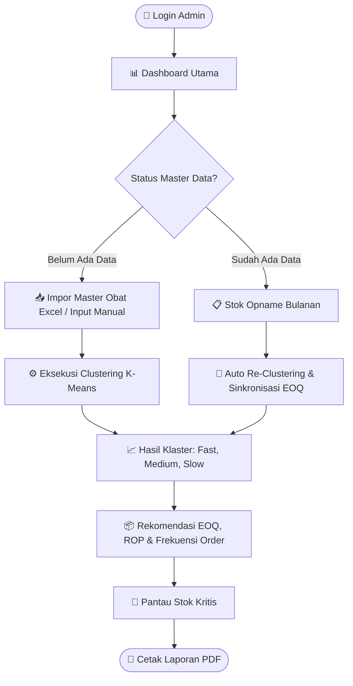
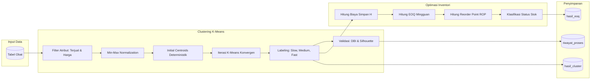
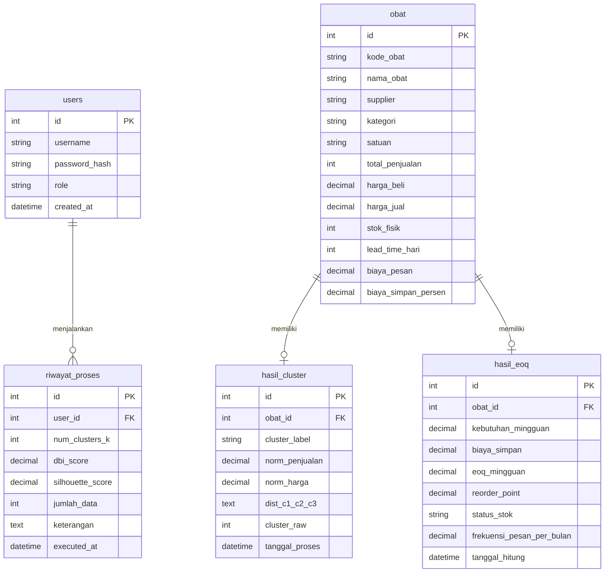

<div align="center">

  

  # Sistem Pendukung Keputusan Pengadaan Obat
  ### Apotek Signa Medika · Kec. Legonkulon, Kab. Subang

  [](https://www.python.org/)
  [](https://flask.palletsprojects.com/)
  [](https://www.mysql.com/)
  [](https://scikit-learn.org/)
  [](https://getbootstrap.com/)
  [](tests/)

  <p align="center">
    Aplikasi web cerdas untuk membantu apoteker menentukan prioritas restock, kuantitas pemesanan ekonomis (<b>EOQ</b>), dan batas titik pemesanan ulang (<b>ROP</b>) secara presisi menggunakan metode <b>K-Means Clustering</b>.
  </p>

  <p align="center">
    <a href="#-fitur-utama">Fitur</a> •
    <a href="#-alur-kerja-sistem">Alur Sistem</a> •
    <a href="#-metode-dan-formula-perhitungan">Metode & Rumus</a> •
    <a href="#-panduan-instalasi">Instalasi</a> •
    <a href="#-format-file-excel">Format Data</a> •
    <a href="#-struktur-folder">Struktur Folder</a> •
    <a href="#-pengujian-sistem">Pengujian</a>
  </p>

</div>

---

## 🌟 Fitur Utama

| Modul | Ikon | Deskripsi Fungsional |
|---|:---:|---|
| **Dashboard Eksekutif** | 📊 | Ringkasan metrik total obat, kartu distribusi cluster (Fast, Medium, Slow), peringatan stok kritis, grafik donat proporsi, serta grafik bar 10 obat terlaris. |
| **Manajemen Obat** | 💊 | Pengelolaan master data obat (CRUD) dan fitur impor massal format Excel/CSV dengan mekanisme **Upsert O(1)** (update instan jika nama obat sudah ada). |
| **Stok Opname Dinamis** | 📋 | Unduh template otomatis berisi seluruh daftar obat terdaftar, input fisik stok berjalan & penjualan bulan ini, unggah kembali, dan sistem otomatis melakukan sinkronisasi serta re-clustering. |
| **K-Means Clustering** | 🔬 | Evaluasi nilai *inertia* kurva **Elbow Method** interaktif, penentuan klaster deterministik berbasis sampel representatif, dan visualisasi scatter plot sebaran data. |
| **Rekomendasi EOQ & ROP** | 📦 | Perhitungan otomatis kuantitas order ekonomis mingguan (EOQ), batas titik pemesanan ulang (ROP), estimasi kebutuhan mingguan, serta frekuensi order bulanan. |
| **Monitoring Stok Kritis** | 🚨 | Deteksi obat dengan kondisi `Stok Fisik <= ROP` yang terintegrasi langsung dengan lonceng notifikasi *badge* di bilah navigasi atas (*header*). |
| **Pelaporan & Ekspor PDF** | 📑 | Pratinjau tabel rekapitulasi komprehensif metrik apotek dan ekspor cetak dokumen formal PDF siap pakai via xhtml2pdf. |

---

## 🛠️ Arsitektur & Teknologi

```
├── Backend       : Python 3.11.2, Flask 3.0.3 (Pola MVC dengan Blueprint Modular)
├── ORM & DB      : Flask-SQLAlchemy 3.1, Flask-Migrate (Alembic), PyMySQL (MySQL / MariaDB)
├── Autentikasi   : Flask-Login 0.6, Werkzeug Security (Password Hashing)
├── Data Science  : scikit-learn 1.5, pandas 2.2, NumPy 1.26
├── Dokumen & IO  : openpyxl (Excel Parser & Generator), xhtml2pdf (PDF Renderer)
├── Antarmuka     : Bootstrap 5.3, Bootstrap Icons, Chart.js, Vanilla CSS Custom Design
└── Test Suite    : pytest 8.3 (In-Memory SQLite Session Fixture)
```

---

## 🔄 Alur Kerja Sistem

### 1. Alur Pengguna (User Journey)



### 2. Alur Pemrosesan Data & Perhitungan Algoritma



> [!NOTE]
> Setiap kali proses kalkulasi dijalankan ulang, entri pada tabel `hasil_cluster` dan `hasil_eoq` diperbarui secara atomik, dan rekam jejak eksekusi dicatat ke tabel `riwayat_proses`.

---

## 📐 Metode dan Formula Perhitungan

Logika perhitungan matematis diimplementasikan secara terpusat pada file [`app/services/kmeans_service.py`](app/services/kmeans_service.py).

### 1. Normalisasi Data (Min-Max Scaler)
Menghindari dominasi atribut skala besar (Harga Jual dalam puluhan ribu rupiah) terhadap atribut skala kecil (Jumlah Penjualan dalam unit):

$$X' = \frac{X - X_{min}}{X_{max} - X_{min}}$$

### 2. Centroid Awal Deterministik (K = 3)
Centroid awal dihitung dari nilai rata-rata sampel representatif data riil apotek, menjamin stabilitas klaster yang identik pada setiap eksekusi:

| Klaster | Kategori | Sampel Representatif Obat |
|:---:|---|---|
| **C1** | Slow Moving | *Madu Hitam Diabet*, *Madu Hitam Propolis 69*, *Sari Mengkudu Prima* |
| **C2** | Fast Moving | *Amoxicillin HJ 500mg Tabet*, *Metformin HJ 500mg Tab*, *Voltadex 50 mg Tab* |
| **C3** | Medium Moving | *Acetylcystein 200 mg Sampharind*, *Aciclovir Cr 5% First Medipharma*, *Aciclovir Cr 5% Indofarma*, *Acifar 200 Mg Tab* |

### 3. Validasi Kualitas Klaster
* **Davies-Bouldin Index (DBI)**: Mengukur rasio sebaran dalam klaster terhadap jarak antarklaster. Nilai yang semakin kecil mendekati nol merepresentasikan pemisahan klaster yang semakin optimal.
* **Silhouette Coefficient**: Mengukur derajat kedekatan data terhadap klasternya sendiri dibandingkan dengan klaster tetangga terdekat:
  $$s(i) = \frac{b(i) - a(i)}{\max(a(i), b(i))}$$

### 4. Economic Order Quantity (EOQ) & Reorder Point (ROP)
Kalkulasi berbasis kebutuhan mingguan (standar 52 minggu kerja per tahun):

| Parameter | Notasi | Formula Perhitungan |
|---|:---:|---|
| **Permintaan Mingguan** | $D_{minggu}$ | $\frac{\text{Penjualan Bulanan} \times 12}{52}$ |
| **Biaya Simpan Tahunan** | $H_{tahun}$ | $\frac{\text{Biaya Simpan \%}}{100} \times \text{Harga Beli}$ |
| **Biaya Simpan Mingguan** | $H_{minggu}$ | $\frac{H_{tahun}}{52}$ |
| **Economic Order Quantity** | $EOQ$ | $\left\lceil \sqrt{\frac{2 \times D_{minggu} \times \text{Biaya Pesan}}{H_{minggu}}} \right\rceil$ |
| **Reorder Point** | $ROP$ | $\left\lceil D_{minggu} \times \frac{\text{Lead Time (Hari)}}{7} \right\rceil$ |
| **Frekuensi Order** | $F$ | $\max\left(1, \left\lceil \frac{\text{Penjualan Bulanan}}{EOQ} \right\rceil\right)$ |

> [!IMPORTANT]
> Obat ditandai sebagai **`Stok Kritis (Harus Reorder)`** jika:
> $$\text{Stok Fisik} \le ROP$$

---

## 🚀 Panduan Instalasi

### Prasyarat Sistem
* Python `3.11.x`
* MySQL Server / MariaDB (misalnya via XAMPP)
* Git CLI

### Langkah Instalasi Cepat

1. **Clone Repositori**
   ```bash
   git clone https://github.com/opalism/project-apotek-signamedika.git
   cd project-apotek-signamedika
   ```

2. **Buat dan Aktifkan Virtual Environment**
   ```bash
   # Windows (PowerShell / CMD)
   python -m venv venv
   .\venv\Scripts\activate

   # Linux / macOS
   python3 -m venv venv
   source venv/bin/activate
   ```

3. **Instal Dependensi Pustaka**
   ```bash
   pip install -r requirements.txt
   ```

4. **Konfigurasi Database MySQL**
   Buka MySQL CLI / phpMyAdmin, lalu buat database baru:
   ```sql
   CREATE DATABASE apotek_signa_medika CHARACTER SET utf8mb4 COLLATE utf8mb4_unicode_ci;
   ```

5. **Setup File Environment (.env)**
   Salin file template [`.env.example`](.env.example) menjadi `.env`:
   ```bash
   cp .env.example .env
   ```
   Sesuaikan konfigurasi koneksi database Anda di file `.env`:
   ```env
   FLASK_APP=run.py
   FLASK_ENV=development
   SECRET_KEY=kunci_rahasia_anda_disini_123
   SQLALCHEMY_DATABASE_URI=mysql+pymysql://root:@localhost/apotek_signa_medika
   ```

6. **Inisialisasi Database (Seeding)**
   Jalankan script inisialisasi:
   ```bash
   python seed.py
   ```
   Script ini akan membuat seluruh tabel, men-setup user administrator, dan jika tersedia file `data-riil.xlsx` di root direktori lokal, sistem akan langsung mengimpor data dan mengeksekusi perhitungan awal.

   > [!WARNING]
   > Menjalankan `seed.py` mengeksekusi `db.drop_all()`. Pastikan hanya dijalankan saat awal instalasi atau reset sistem.

7. **Jalankan Aplikasi Web**
   ```bash
   python run.py
   ```
   Akses melalui browser Anda di: **[http://127.0.0.1:5000](http://127.0.0.1:5000)**

### Kredensial Default Administrator
| Username | Password | Role |
|:---:|:---:|:---:|
| `admin` | `admin123` | Administrator |

---

## 📋 Format File Excel

### 1. Template Impor Data Master Obat
Gunakan sheet bernama `Data Obat` (atau sheet pertama). Template resmi dapat langsung diunduh dari sistem atau melalui file [`data-obat-contoh.xlsx`](data-obat-contoh.xlsx).

| Nama Kolom Header | Tipe Data | Keterangan & Contoh |
|---|:---:|---|
| `Nama Obat` | Teks | Identifier unik nama obat (*Amoxicillin HJ 500mg*) |
| `Supplier` | Teks | Nama PBF / Pemasok resmi (*PT. Kimia Farma*) |
| `Kategori` | Teks | Golongan terapi (*Antibiotik, Analgesik*) |
| `Satuan` | Teks | Satuan kemasan (*Strip, Botol, Tablet*) |
| `Jumlah Terjual per Bulan` | Numerik | Total unit penjualan per bulan (*147*) |
| `Harga Beli (Rp)` | Numerik | Harga modal beli satuan (*4560*) |
| `Harga Jual (Rp)` | Numerik | Harga jual apotek ke konsumen (*6000*) |
| `Stok Rata-rata` | Numerik | Jumlah stok fisik di apotek (*50*) |
| `Lead Time (Hari)` | Numerik | Waktu tunggu pengiriman pemasok (*3*) |
| `Biaya Pesan (Rp)` | Numerik | Biaya administrasi & kirim per pesanan (*5500*) |
| `Biaya Simpan (% per tahun)` | Numerik | Persentase biaya simpan persediaan (*26*) |

### 2. Template Stok Opname
Template ini digenerate secara langsung oleh sistem via tombol **Download Template Opname** pada menu navigasi:
* Kolom `Nama Obat`: Menampilkan seluruh obat terdaftar di database (tidak boleh diubah).
* Kolom `Stok Tersisa Apotek`: Masukkan hasil perhitungan fisik stok riil saat opname.
* Kolom `Terjual Bulan Ini`: Masukkan total penjualan berjalan bulan ini.

---

## 🗄️ Skema Database (ERD)



---

## 📁 Struktur Folder Proyek

```
project-apotek-signamedika/
├── app/
│   ├── __init__.py              # Inisialisasi Flask Application Factory & Blueprints
│   ├── config.py                # Konfigurasi aplikasi dari .env
│   ├── controllers/             # Layer Controller (Flask Blueprints)
│   │   ├── alert_controller.py      # Monitoring stok kritis & API notifikasi lonceng
│   │   ├── auth_controller.py       # Alur otentikasi login & logout
│   │   ├── clustering_controller.py # Kalkulasi Elbow, eksekusi K-Means, & hasil klaster
│   │   ├── dashboard_controller.py  # Statistik utama, metrik ringkasan, & Chart.js
│   │   ├── eoq_controller.py        # Tabel rekomendasi EOQ, ROP, & frekuensi pesan
│   │   ├── laporan_controller.py    # Pratinjau laporan & download berkas PDF
│   │   └── obat_controller.py       # CRUD obat, impor Excel massal, & stok opname
│   ├── models/
│   │   └── models.py            # Definisi model ORM (SQLAlchemy Database Entities)
│   ├── services/
│   │   ├── import_service.py    # Parser Excel Upsert O(1) & sinkronisasi opname
│   │   ├── kmeans_service.py    # Logika inti K-Means, Elbow, DBI, Silhouette, EOQ, ROP
│   │   └── pdf_service.py       # Engine generator berkas cetak PDF via xhtml2pdf
│   ├── static/
│   │   ├── css/style.css        # Custom CSS styling modern antarmuka
│   │   └── img/                 # Logo aset Apotek Signa Medika
│   └── templates/               # Jinja2 Layout Templates per modul
├── migrations/                  # Script versioning skema basis data Alembic
├── tests/                       # Suite pengujian otomatis berbasis pytest
│   ├── conftest.py              # Fixture session SQLite in-memory & auto-skip
│   ├── test_auth.py             # Pengujian proteksi akses & sesi otentikasi
│   ├── test_clustering.py       # Pengujian algoritma K-Means, DBI, & Silhouette
│   ├── test_eoq.py              # Pengujian akurasi formula EOQ, ROP, & batas stok
│   └── test_obat.py             # Pengujian CRUD obat & validasi berkas impor
├── data-obat-contoh.xlsx        # File template resmi impor data obat
├── seed.py                      # Script otomatisasi seeding database
├── run.py                       # File entrypoint server aplikasi
├── requirements.txt             # Daftar dependensi modul Python
├── .env.example                 # Template variabel environment
└── README.md                    # Dokumentasi lengkap proyek
```

---

## 🧪 Pengujian Sistem

Proyek ini telah dilengkapi dengan suite pengujian otomatis menyeluruh (**40 Test Cases**) menggunakan **pytest**:

```bash
pytest
```

```text
============================= test session starts =============================
platform win32 -- Python 3.11.2, pytest-8.3.2, pluggy-1.6.0
collected 40 items

tests\test_auth.py ......                                                [ 15%]
tests\test_clustering.py ...............                                 [ 52%]
tests\test_eoq.py ..........                                             [ 77%]
tests\test_obat.py .........                                             [100%]

============================== 40 passed in 20.20s ==============================
```

### Matriks Pengujian Unit
| Test Suite | Jumlah Kasus | Area yang Diuji |
|---|:---:|---|
| [`test_auth.py`](tests/test_auth.py) | **6 Tests** | Validasi form login, verifikasi hash password, penolakan kredensial invalid, pemblokiran rute terproteksi tanpa sesi, dan alur logout. |
| [`test_obat.py`](tests/test_obat.py) | **9 Tests** | Alur CRUD data obat, proteksi 404 ID obat tidak ditemukan, validasi upload file tanpa berkas, penolakan ekstensi file ilegal, dan unduhan template. |
| [`test_clustering.py`](tests/test_clustering.py) | **15 Tests** | Eksekusi K=2 dan K=3, integritas simpan database, validasi nama label moving, guard clause data minimum, sebaran cluster, akurasi DBI & Silhouette, serta monotonitas kurva inertia Elbow. |
| [`test_eoq.py`](tests/test_eoq.py) | **10 Tests** | Kelengkapan data seluruh obat, validasi nilai positif, presisi kalkulasi EOQ, akurasi nilai ROP, pembulatan kebutuhan mingguan, batas minimum frekuensi pemesanan, dan penanganan biaya simpan nol. |

---

<div align="center">
  <sub>Dikembangkan untuk Tugas Akhir · Sistem Informasi Apotek Signa Medika · 2026</sub>
</div>
